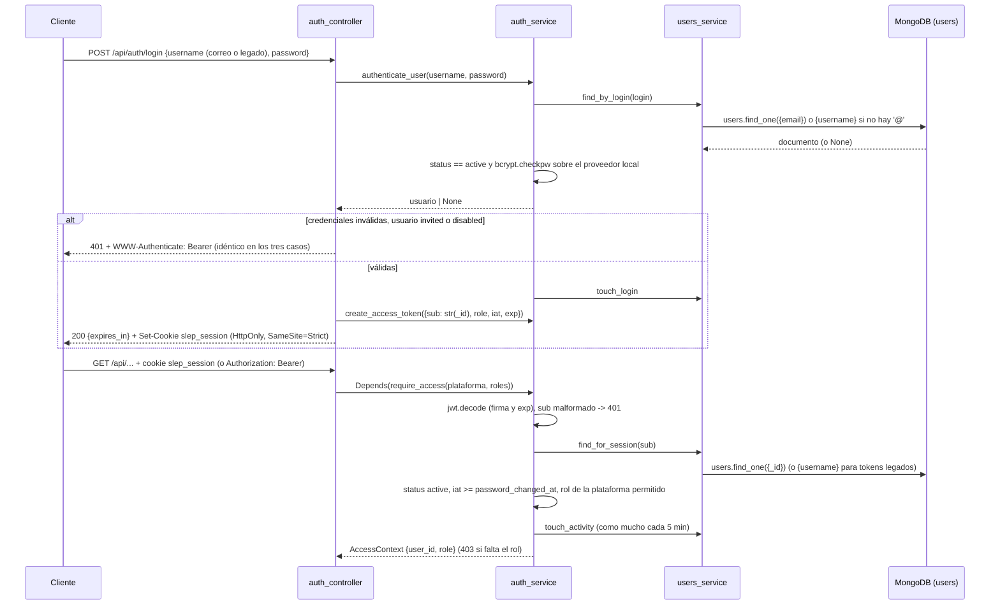
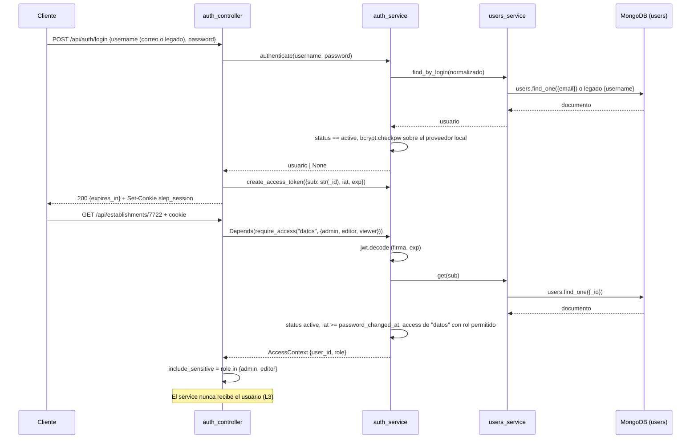
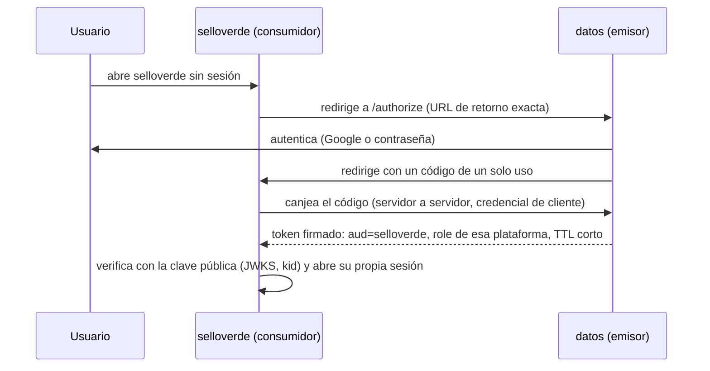

# 04 · Seguridad y control de acceso

> **Estado (2026-10-09, rama `feature/usuarios-f4`).** Las secciones 1 a 8 describen el código
> **tal como queda tras las fases F3 y F4** (identidad en el módulo `users`, `require_access`, sesión
> revocable, política de contraseñas, primer acceso por enlace, auditoría y límite de intentos). La §9
> conserva el diseño completo y marca con ✅ lo implementado y con 🧭 lo pendiente (F7). El login con Google (F6) está implementado.
> La §10 es el marco de interconexión (F7), solo diseño.

---

## 1. Flujo de autenticación

**Hashing** (`auth_service.py`): `bcrypt` directo con costo `BCRYPT_ROUNDS` (12), contraseña
normalizada NFKC y límite de 72 bytes (más allá, `bcrypt` 5 lanza `ValueError`: la política
lo rechaza antes con 422). Si el usuario no existe se verifica contra un hash de relleno para
igualar el tiempo de respuesta.

**Emisión:** payload `{sub: str(_id), role, iat, exp}` firmado HS256 con `settings.JWT_SECRET`
(sin default, T9; mínimo 32 caracteres y sin valores de ejemplo ni públicos, SEC-1, `test_BE51_*`). Expiración por defecto 180 minutos. `role` va en el token por compatibilidad
pero **no se usa nunca para autorizar**.

**Verificación (`get_current_user`):** decodifica, extrae `sub` y **vuelve a leer el usuario**.
Esa relectura es la decisión de diseño más importante del módulo:

> **El rol efectivo sale del documento de `users` recién leído, no del token.** Degradar,
> desactivar o quitarle un acceso a alguien surte efecto en su siguiente petición. El costo es
> una consulta a MongoDB por request autenticada; a esta escala es el intercambio correcto, y
> en un escenario de alto tráfico sería el primer candidato a caché, reintroduciendo
> conscientemente una ventana de propagación.

Devuelve `401` si: firma o `exp` inválidos, falta alguno de los claims `exp`, `iat` o `sub`
(`options={"require": [...]}`, SEC-2; el algoritmo está fijado a HS256, así que `alg: none` y HS512
se rechazan), `sub` ausente o malformado (un objeto de operadores da `401`, no `500`), usuario
inexistente, usuario que **no está `active`** (`invited` o `disabled`), token emitido **antes del
último cambio de contraseña** (`iat` menor que `password_changed_at`, comparado al segundo) o
token emitido **hasta el instante de la última revocación** (`iat <= sessions_revoked_at`, §9.4). Todo fallo es el mismo `401` con
`WWW-Authenticate: Bearer`; no se distingue el motivo hacia afuera.

El `sub` aceptado es `str(_id)`. Mientras dure la compatibilidad también se acepta el username
legado del admin sembrado (`sub = "admin"`). Se retira una versión después de F3.

**Cookie de sesión (✅ F6 S3, ADR-016).** El JWT se entrega **solo** en `Set-Cookie: slep_session`
(`HttpOnly`, `SameSite=Strict`, `Path=/api`, `Max-Age` = vigencia, `Secure` si `PUBLIC_BASE_URL` es https) y
nunca en el cuerpo: un XSS ya no tiene un token que robar (`test_BE59_*`, `test_FE18_*`). `_issue_token` sigue
siendo el único punto de emisión. `get_current_user` toma el token de la cabecera `Authorization` (clientes no
navegador; tiene prioridad) o, si no hay, de la cookie. **Con cookie**, toda petición que no sea GET/HEAD/OPTIONS
exige `Origin == PUBLIC_BASE_URL` (si no, `403 untrusted_origin`): `SameSite=Strict` no frena a un sitio
*hermano* (otro subdominio del mismo dominio registrable cuenta como «same-site»); el `Origin` sí. La cabecera
Bearer no es una credencial ambiental, así que no pasa por ese control. No hay CORS (SEC-5), por lo que
ningún origen ajeno puede leer respuestas.

**Lado cliente** (`App.jsx`, `Login.jsx`, `AppLayout.jsx`): no se guarda nada en el navegador. Al montar,
`App` llama `GET /api/auth/me`; un `401` significa «sin sesión». Un interceptor de respuesta cierra la sesión de
la vista ante **cualquier `401`**, por eso un endpoint que valida una contraseña (cambio propio) responde `400`
y nunca `401` ante la clave actual errónea. `App` purga el `token` que versiones anteriores dejaron en
`localStorage`. El cierre de sesión llama `POST /api/auth/logout`, que revoca las sesiones y borra la cookie.

> ✅ **RESUELTO (F6 S3):** la brecha «token en `localStorage`» (robo por XSS) quedó cerrada. Siguen
> abiertos los límites de §7: la CSP está en `Report-Only` y un XSS aún podría *usar* la sesión desde la
> propia página (hacer peticiones como la persona mientras dure la visita), aunque ya no puede *llevarse* el token.

---

## 2. Modelo de roles

Cada usuario tiene `access[]`: una entrada `{platform_id, role}` por plataforma (`iam`, `datos`,
`selloverde`). Los roles válidos de cada plataforma salen de la colección `platforms`
(`admin`, `editor`, `viewer`; `iam` solo tiene `admin`). **`iam/admin` (admin global) y
`datos/admin` son roles distintos** (separación de funciones, C12). ADR-009.

- **Punto de aplicación:** la dependencia `require_access(plataforma, roles)`
  (`auth_service.py`). Cada ruta la declara; devuelve un `AccessContext {user_id, role}`; `401`
  si la sesión no es válida, `403` si falta el rol. `require_access(None)` exige solo un usuario
  autenticado y activo (por ejemplo `/me`).
- **Garantía por test:** `test_BE12_every_route_declares_access_or_is_allowlisted` recorre las
  rutas reales y falla ante una ruta sin `require_access` fuera de la allowlist explícita
  (`GET /`, `login`, `login-form`, `logout`, `password-policy`).
- El service nunca recibe el usuario (L3): el controller traduce el rol a booleanos
  (`include_sensitive = ctx.role in {admin, editor}`).

### 2.1 Matriz recurso × rol × operación

| Operación | Anónimo | `viewer` | `editor` | `admin` (`datos`) | `iam/admin` |
|---|---|---|---|---|---|
| `GET /`, `/docs`, `/redoc`, `/openapi.json`, `POST /api/auth/login`, `/login-form`, `/logout`, `GET /api/auth/password-policy` | ✅ | ✅ | ✅ | ✅ | ✅ |
| `GET /api/auth/me`, `GET`/`PATCH /api/users/me`, `POST /api/auth/password`, `GET /api/units*` | ❌ 401 | ✅ | ✅ | ✅ | ✅ |
| `GET` de establecimientos, contrapartes, métricas y analytics | ❌ 401 | ✅ | ✅ | ✅ | solo si además tiene rol en `datos` |
| Detalle de establecimiento: `connectivity.ssid_password` | — | ❌ `[REDACTED]` | ✅ en claro | ✅ en claro | según su rol en `datos` |
| `PUT /api/establishments/{rbd}`, `POST`/`PUT` contrapartes, `PUT` métricas | ❌ 401 | ❌ 403 | ✅ | ✅ | según su rol en `datos` |
| `DELETE /api/counterparts/{id}` | ❌ 401 | ❌ 403 | ❌ 403 | ✅ | según su rol en `datos` |
| `/api/users/*` (salvo `/me`), escritura en `/api/units/*`, `/api/platforms/*` | ❌ 401 | ❌ 403 | ❌ 403 | ❌ 403 | ✅ |

Un usuario autenticado **sin ningún rol en `datos`** (por ejemplo, solo `selloverde`) recibe `403` en
todas las rutas de datos, y `GET /api/auth/me` le devuelve `role: "none"`. Un `role` desconocido
en `access[]` no concede nada. Ejecutada por HTTP real en `test_INT03_role_matrix_over_http`.

> **El editor ve credenciales en claro (C20) — confirmado por el usuario el 2026-10-06.** Antes
> solo las veía el admin. La credencial del WiFi de los establecimientos es de
> uso público dentro de la institución, así que el riesgo se acepta de forma explícita. Si algún día
> dejaran de serlo, `SENSITIVE_ROLES` en `auth_entity.py` pasa a `{admin}` y el resto de las
> garantías (incluida la protección de la sobrescritura, §3.2) sigue valiendo.

> ✅ **RESUELTO (D3):** `viewer` ya no escribe nada; `editor` no borra.
> ✅ **RESUELTO (D4):** el `PUT` respeta `include_sensitive` y nadie sin rol de escritura llega a él.
> ✅ **RESUELTO:** existe la dependencia reutilizable `require_access`.

---

## 3. Protección de campos sensibles

Dos mecanismos independientes, con alcances distintos. Confundirlos es la fuente de error más
probable al modificar el listado o el detalle.

### 3.1 Exclusión por proyección — protege el **listado**

`LISTING_PROJECTION` (`establishments_service.py:6-17`) es una proyección **de inclusión**:
enumera los 10 campos que se leen y MongoDB descarta todo lo demás en el servidor de base de
datos. `connectivity` y `printers` no viajan siquiera dentro del proceso Python.

Esta protección es **por lista blanca**, y eso importa: un campo sensible nuevo en el documento
queda protegido en el listado **por omisión**. Es el mecanismo robusto de los dos.

### 3.2 Redacción por rol — protege el **detalle**

`find_by_rbd(rbd, include_sensitive=False)` (`establishments_service.py:84-95`) sustituye por
la cadena literal `"[REDACTED]"`:

- `connectivity.ssid_password` si no está vacío. (`licenses[].password` se redactaba también; el campo se retiró en F6, N15.)

El controller decide el booleano (`establishments_controller.py`, `include_sensitive = ctx.role in
SENSITIVE_ROLES`): solo `viewer` recibe `[REDACTED]`. El service nunca sabe qué es un rol; el
controller nunca sabe qué campo se redacta. Esa separación permite probar ambos lados por
separado y es la que hay que preservar. El `PUT` pasa el mismo booleano a `update_by_rbd`, de
modo que su respuesta tampoco devuelve credenciales a quien no corresponde (cierra D4).

**El marcador `[REDACTED]` nunca se persiste.** Un cliente que recibió el detalle redactado y lo
reenvía completo en el `PUT` (así lo hace `EditFicha.jsx:35` y `:173-175`) no destruye las
credenciales: `_resolve_redacted_markers` conserva el valor almacenado si hay uno equivalente
(el `ssid_password` existente) y responde `422`
si no lo hay. Verificado por `test_BE13_*` y `test_INT04_*`.

Esta protección es **por lista negra**, con dos entradas literales. Un campo sensible nuevo
**no** queda protegido por omisión: hay que agregarlo a mano.

> 🔸 **BRECHA:** la redacción es destructiva sobre el documento que ya se leyó completo desde
> MongoDB. El dato sensible sí cruzó la frontera de la base al proceso. En caso de excepción
> entre la lectura y la redacción, o de un log que serialice el documento antes de redactar,
> el valor real queda expuesto. Lo robusto sería no leerlo (proyección de exclusión) cuando no
> se necesita.
>
> ✅ **RESUELTO (N15, F6):** `licenses` se retiró. Ya no hay `licenses[].email` sin redactar ni contraseñas
> de plataformas externas guardadas por la aplicación.

---

## 4. Invariantes garantizados por los tests

Los tests del backend son la **especificación ejecutable** de esta sección. Un cambio que los
rompa está cambiando una garantía de seguridad, no un detalle de implementación.

| Invariante | Test que lo protege | Qué se rompe si se viola |
|---|---|---|
| `LISTING_PROJECTION` existe como constante exportable de `establishments_service` | `test_BE03_listing_projection_constant_exists` | Cualquier refactor que la haga local o inline |
| La proyección **excluye** `licenses` (retirado), `connectivity`, `printers` | `test_BE03_listing_projection_excludes_sensitive_fields` | Agregar cualquiera de los tres a la proyección "para que la UI no pida el detalle" |
| La proyección **incluye** los campos que el directorio necesita | `test_BE03_listing_projection_includes_required_fields` | Quitar un campo del listado y romper la tabla del frontend |
| `find_all()` pasa efectivamente la proyección al cursor | `test_BE03_find_all_applies_projection_to_cursor` | Declarar la constante y olvidar usarla |
| Ningún documento del listado tiene `licenses` | `test_BE03_find_all_result_has_no_licenses_field` | Regresión del anterior, verificada sobre el resultado |
| `find_by_rbd()` **no** usa la proyección del listado | `test_BE06_find_by_rbd_returns_full_document_not_projected` | "Unificar" ambas lecturas en una sola con proyección — vaciaría la ficha |
| El payload del listado completo pesa < 50 KB | `test_BE03` (docstring) | Reintroducir bloques pesados en el listado |
| `find_by_rbd()` acepta `include_sensitive` | `test_BE05_find_by_rbd_accepts_include_sensitive_param` | Cambiar la firma sin adecuar el controller |
| No-admin recibe `ssid_password == "[REDACTED]"` | `test_BE05_non_admin_receives_redacted_ssid_password` | Olvidar el segundo campo al refactorizar |
| Admin recibe el `ssid_password` real | `test_BE05_admin_receives_real_ssid_password` | — |
| El controller pasa `include_sensitive=True` solo para admin | `test_BE05_controller_passes_include_sensitive_true_for_admin` / `..._false_for_viewer` | Mover la decisión de rol al service, o hardcodearla |
| **Integración:** `GET /api/establishments` nunca incluye `licenses` en ningún ítem | `test_INT02_listing_response_never_contains_licenses_field` | Cualquier regresión de los anteriores, vista desde HTTP real |
| **Integración:** el JSON del listado no contiene la clave `password` en ninguna parte | `test_INT02_listing_response_does_not_contain_password_string_anywhere` | Agregar un campo que contenga la subcadena `password` al listado |
| **Integración:** el detalle con token no-admin trae passwords redactadas | `test_INT02_detail_with_non_admin_token_returns_redacted_passwords` | — |
| **Integración:** el detalle con token admin trae passwords reales | `test_INT02_detail_with_admin_token_returns_real_passwords` | — |
| **Integración:** la matriz de roles completa por HTTP con tres tokens y anónimo | `test_INT03_role_matrix_over_http` | Cambiar una celda de 2.1 sin darse cuenta |
| Toda ruta declara `require_access` o está en la allowlist | `test_BE12_every_route_declares_access_or_is_allowlisted` | Una ruta nueva sin protección |
| `viewer` no escribe; `editor` no borra; sin rol en `datos` ⇒ `403`; `datos/admin ≠ iam/admin` | `test_BE12_*` | Volver a D3 |
| El `PUT` no devuelve credenciales a quien no puede escribir; el marcador no sobrescribe el secreto | `test_BE13_*`, `test_INT04_*` | Volver a D4 y a la pérdida de datos de `EditFicha` |
| `sub = str(_id)`; sesiones cortadas por desactivación y por cambio de contraseña; todos los fallos dan el mismo `401` | `test_BE11_*` | Un token sobrevive a la desactivación |
| Ninguna respuesta de usuarios contiene `hashed_password`, `token_hash` ni un hash bcrypt; `personal_phone` solo para el admin global y el propio usuario | `test_INT07_*` | Fuga de credenciales o de datos personales |
| Operadores (`{"$ne": null}`) y campos extra en cualquier body de escritura dan `422`; falla si aparece una ruta de escritura sin revisar | `test_INT08_*` | Inyección de operadores y asignación masiva |
| Variables de identidad y secreto sin default; todas declaradas en compose y plantilla | `test_BE14_*` | Volver a D2 |

Los tests corren contra MongoDB **mockeado** (`tests/conftest.py`: `AsyncMock`/`MagicMock`
sobre `db_service.db`), no contra una instancia real. Verifican la lógica del backend, no el
comportamiento de MongoDB ni la existencia física de los índices.

> ✅ **RESUELTO:** la fuga por `PUT` ya tiene test (`test_INT04_*`).

---

## 5. CORS

> ✅ **RESUELTO (SEC-5, F6):** el backend ya **no monta `CORSMiddleware`** (`main.py`). El
> frontend va por rutas relativas detrás del mismo origen (Nginx o el proxy de Vite, ADR-008), así
> que ningún origen ajeno necesita leer respuestas: el navegador las bloquea (`test_BE54_*`).
> `Retry-After` sigue siendo legible desde el mismo origen. Si alguna vez se sirve el frontend
> desde otro origen, hay que agregar una **lista explícita** de orígenes por variable de entorno,
> nunca `*` con credenciales.

---

## 6. Secretos y configuración

`config.py` (`Settings`) lee el entorno **al instanciarse** y valida (T9). Las variables de
identidad y de secreto **no tienen default**: si falta una, la app no arranca y el mensaje nombra
la variable (`ConfigError`). `repr(settings)` no vuelca valores.

| Variable | Default | Validación |
|---|---|---|
| `MONGODB_URL` | `mongodb://localhost:27017` | — (falla ruidosamente al conectar) |
| `DATABASE_NAME` | `slep_llanquihue` | — |
| `JWT_SECRET` | **ninguno** | obligatoria, ≥ 32 caracteres, distinta de los valores públicos del repositorio (SEC-1) |
| `ADMIN_PASSWORD` | **ninguno** | obligatoria; solo se usa para crear el admin con la base vacía |
| `ACCESS_TOKEN_EXPIRE_MINUTES` | `180` | entero ≥ 1 |
| `BOOTSTRAP_ADMIN_EMAIL` | **ninguno** | obligatoria; debe pertenecer a `ALLOWED_EMAIL_DOMAINS` |
| `ALLOWED_EMAIL_DOMAINS` | **ninguno** | lista separada por comas, dominios válidos, normalizados |
| `PASSWORD_MIN_LENGTH` | `15` | entero ≥ 8 y ≤ `PASSWORD_MAX_LENGTH` |
| `PASSWORD_MAX_LENGTH` | `64` | entero ≥ 64 |
| `PASSWORD_REQUIRE_CHAR_CLASSES` | `0` | entero de 0 a 4 |

> ✅ **RESUELTO (D2):** `JWT_SECRET` y `ADMIN_PASSWORD` ya no tienen default en el código, y no
> queda ningún secreto del repositorio en `config.py` (`test_BE14_jwt_secret_and_admin_password_have_no_default`).
> `Settings` valida en rango y falla con un mensaje útil (ya no un `ValueError` en el import).
>
> ✅ **RESUELTO (SEC-1, F6):** `docker-compose.yml` (desarrollo) ya no trae secretos literales: lee
> `${JWT_SECRET}` y `${ADMIN_PASSWORD}` del `.env` de la raíz y no levanta sin ellos. `Settings`
> exige `JWT_SECRET` de al menos 32 caracteres y rechaza los valores que estuvieron versionados
> (guardados como sha256 para no reescribirlos en el código) y los marcadores `CAMBIA_ESTO…` de la
> plantilla, también para `ADMIN_PASSWORD` (`test_BE51_*`). Los valores legados siguen en el
> historial de git: **cualquier despliegue que los haya usado debe rotarlos**.
>
> 🔸 **BRECHA:** para `/docs` y `/openapi.json` públicos, ver §7.

**Producción:** `.env.production.template` incluye el comando para generar el secreto
(`python -c "import secrets; print(secrets.token_hex(64))"`), `docker-compose.prod.yml` los inyecta
por entorno junto con la autenticación de MongoDB, y `scripts/deploy.sh` valida en su paso 1 las
siete variables críticas (`MONGO_ROOT_*`, `JWT_SECRET`, `ADMIN_PASSWORD`, `DATABASE_NAME`,
`BOOTSTRAP_ADMIN_EMAIL`, `ALLOWED_EMAIL_DOMAINS`). Un test comprueba que toda variable que lee
`Settings` está declarada en la plantilla y en los dos compose
(`test_BE14_every_env_var_declared_in_templates_and_compose`).

---

## 7. Superficie expuesta y lo que no existe

| Aspecto | Estado |
|---|---|
| TLS | Fuera del repositorio. Nginx escucha en `:80` y se publica en `127.0.0.1:8080` |
| MongoDB en producción | No publicada al host; auth root habilitada |
| Rate limiting | ✅ Login, canje de enlaces, reenvío y restablecimiento (§9.5). Sin Redis: colección `rate_limits` con TTL |
| Bloqueo por intentos fallidos | **Deliberadamente no hay bloqueo de cuenta**: el límite es por (cuenta + IP), para que un tercero no pueda dejar inutilizable la cuenta de otro |
| Auditoría de cambios | ✅ `audit_log` de solo agregado: quién cambió qué en usuarios, accesos, unidades, plataformas y subrogancias. **Las lecturas no se auditan** (ADR-014) |
| Validación de entrada | Pydantic con `extra="forbid"` y tipos escalares en toda la feature de usuarios (`test_INT08_*`). Los filtros de texto de establecimientos y la búsqueda de usuarios escapan el input con `re.escape` (D5 cerrada en F6, `test_INT10_*`) |
| Cabeceras de seguridad | ✅ (SEC-6, `test_BE55_*`) `nginx.conf` define `nosniff`, `X-Frame-Options: DENY`, `Referrer-Policy`, `Permissions-Policy` y una **CSP en modo `Report-Only`** (pasa a enforzada cuando se verifique en el navegador sin violaciones). **HSTS no va en este nginx** (escucha en `:80`, el TLS termina afuera): debe ponerlo el terminador TLS (`07` §5.3) |
| `/openapi.json`, `/docs` | **Públicos** — exponen el esquema completo a cualquiera |
| Secretos en el repositorio | `establishments.json` y los `.xlsx`/`.json` de `Documentacion/` están git-ignored. `config.py` ya no contiene ningún secreto (D2 resuelta); `docker-compose.yml` de desarrollo sí tiene valores literales solo-desarrollo |

> ✅ **Cerrado en F4:** el login ya no admite fuerza bruta ilimitada (5 fallos por cuenta e IP, 30 por IP, en
> 15 minutos; `429` con `Retry-After`). Queda una condición operativa: **la IP real del cliente debe llegar
> al backend**. nginx la deja en `X-Forwarded-For` y Gunicorn la aplica con `--forwarded-allow-ips`, pero
> **hay un proxy del host delante** (`127.0.0.1:8080`) cuya configuración no está en el repositorio: si no
> reenvía `X-Forwarded-For`, todas las peticiones parecerían venir de una misma IP y el límite por IP se
> compartiría entre todos. Verificarlo en el primer despliegue (`07` §7).

---

## 8. Checklist antes de tocar código de esta área

1. ¿El campo que agrego es sensible según `02-modelo-datos.md` §7? Si sí: **no** lo agregues a
   `LISTING_PROJECTION` y **sí** agrégalo a la redacción de `find_by_rbd`.
2. ¿Estoy cambiando `LISTING_PROJECTION`? Corre `test_BE03` e `test_INT02` y **presenta la
   salida real** (regla 1 de `GEMINI.md`).
3. ¿Estoy tocando `auth/`? Es un punto único de falla: rama aislada y punto de restauración
   antes de empezar (regla 3 de `GEMINI.md`).
4. ¿Mi endpoint nuevo escribe datos? Decide explícitamente si debe exigir admin, y si la
   respuesta puede contener campos sensibles. Hoy no hay ninguna dependencia que lo haga por ti.
5. ¿Mi endpoint devuelve un documento de establecimiento? Verifica por qué rama de
   `include_sensitive` pasa.

---

## 9. Modelo de acceso por plataforma (✅ F3, F4 y F6)

> **Estado por subsección.** ✅ Implementado y verificado: 9.1 (flujo, sin la parte de Google), 9.2, 9.3,
> 9.4, 9.5 completa (F3: política, cambio propio y bootstrap; F4: invitación, reenvío, restablecimiento y
> canje por enlace, rate limiting), 9.6 (login con Google y alta automática, F6, ADR-015), 9.7 y 9.8. La
> auditoría de ADR-014 también (F4).
> Decisiones: ADR-009 (acceso y roles), ADR-012 (primer acceso),
> ADR-013 (dependencias) y ADR-014 (auditoría y límites) en `06`. Modelo de datos en `02` §9;
> contrato en `03` §8. **Documento obligatorio antes de tocar `auth/`:** F3 y F6 tocan un punto
> único de falla, así que valen la rama aislada y los tests BE03, BE05 e INT02 antes y después.

### 9.1 Flujo objetivo

El flujo conserva la decisión de diseño de §1: el rol **no** se toma del token sino del documento
recién leído, de modo que revocar un acceso o desactivar a alguien surte efecto en su siguiente
petición, sin ventana de propagación. El costo sigue siendo una consulta por request autenticada.

### 9.2 `require_access(platform, roles)`

Dependencia de FastAPI definida en `auth`, que cada controller declara por ruta
(`Depends(require_access("datos", {"admin", "editor"}))`). Devuelve un `AccessContext {user_id,
role}`. Responde `401` si la sesión no es válida (token, usuario inexistente o no `active`,
sesión anterior a un cambio de contraseña) y `403` si el usuario no tiene un rol permitido en esa
plataforma. Un rol desconocido en `access[]` no concede nada. Reemplaza la comparación inline de
`establishments_controller.py:40`.

**Toda ruta declara `require_access` o está en una allowlist explícita** (`/`, `/docs`, `/redoc`,
`/openapi.json`, `login`, `login-form`, `logout`, `password-policy`, `set-password`,
`auth/config`, `auth/google`). Un test recorre `app.routes` y falla ante una ruta nueva sin
declarar. Cierra la brecha «no existe dependencia reutilizable tipo `require_admin`» de §2.

### 9.3 Matriz de roles

Las tres plataformas comparten los roles `admin` (ver, editar y eliminar), `editor` (ver y
editar) y `viewer` (solo ver); `iam` solo tiene `admin`. Reemplaza la matriz de §2.1.

| Operación en `datos` | `viewer` | `editor` | `admin` |
|---|---|---|---|
| `GET` de establecimientos, contrapartes, métricas y analytics | ✅ | ✅ | ✅ |
| Ver `ssid_password` en claro | ❌ redactado | ✅ | ✅ |
| `PUT` / `POST` de ficha, contrapartes y métricas | ❌ `403` | ✅ | ✅ |
| `DELETE /api/counterparts/{id}` | ❌ `403` | ❌ `403` | ✅ |
| `/api/users/*` (salvo `/me`), escritura en `/api/units/*` y `/api/platforms/*`, `/api/audit` | solo con `iam/admin` | solo con `iam/admin` | solo con `iam/admin` |
| `GET` y `PATCH /api/users/me`, `GET /api/units*`, `POST /api/auth/password` | ✅ | ✅ | ✅ |

**`datos/admin` no es `iam/admin`**: separación de funciones (C12). **Sin acceso a `datos` ⇒ `403`**
en todas las rutas de datos, aunque el usuario esté autenticado.

> ⚠️ **Amplía quién ve secretos.** Hoy solo el admin ve `ssid_password`.
> Con esta matriz también los ve el `editor` (lectura confirmada de la respuesta N10). Si esa
> lectura fuera errónea, `include_sensitive` queda solo para `admin` y la protección contra la
> sobrescritura de secretos redactados (9.7) deja de ser inalcanzable solo por diseño.

### 9.4 Sesión y revocación

- El `sub` del JWT es `str(_id)`: estable, nunca el correo ni un username. `get_current_user`
  acepta además los `sub = username` legados mientras dure la migración. Un `sub` malformado da
  `401`, no `500`.
- El token lleva `iat`. **Se rechaza un token con `iat` anterior a `password_changed_at`** del
  usuario; la comparación se hace truncada al segundo para no rechazar el token emitido en el
  mismo segundo del cambio. Cambiar o restablecer la contraseña cierra todas las sesiones previas.
  El cambio propio devuelve un token nuevo para que la sesión actual continúe.
- **Revocación sin estado (SEC-3):** `users.sessions_revoked_at` (ausente = sin corte, no necesita
  migración). Se rechaza el token con `iat <= sessions_revoked_at` (aquí el segundo del corte
  también se invalida, a diferencia de la contraseña: un logout inmediato al login debe cortar ese
  token). Lo fijan `POST /api/auth/logout` y la **desactivación**; reactivar a la persona **no**
  revive los tokens anteriores. Restablecer o cambiar la contraseña ya corta por
  `password_changed_at`. **El logout corta todas las sesiones de la persona** (todos sus
  dispositivos): es la forma sin estado, no hay lista de tokens. Sirve también a las cuentas de
  Google, que no tienen `password_changed_at` (`test_BE53_*`).
- Un usuario `disabled` o `invited` con token vigente recibe `401` en la siguiente request.
- Todo fallo de autenticación sigue siendo el mismo `401` con `WWW-Authenticate: Bearer`.
- `last_login_at` se escribe en cada login; `last_activity_at` como máximo cada 5 minutos por
  usuario, con un `update_one` condicional (seguro con 2 workers) y sin consulta extra.
- Una contraseña actual incorrecta al cambiarla responde `400`/`403`, **nunca `401`**: el
  interceptor del frontend (`App.jsx:38`) cierra la sesión ante cualquier `401`.

### 9.5 Primer acceso, restablecimiento y contraseñas

- **La contraseña nunca viaja por correo.** Alta ⇒ usuario `invited` ⇒ correo con un enlace de un
  solo uso (`/definir-contrasena#token=…`, en el fragmento) que además ofrece entrar con Google.
  Canjearlo define la contraseña y activa al usuario. Mecanismo, vigencia (72 h / 24 h) y
  atomicidad del canje: ADR-012 y `02` §9.7. Todo fallo de canje responde igual, sin distinguir
  usado, vencido o inexistente.
- **Restablecer** (solo `iam/admin`) usa el mismo mecanismo con `purpose: reset`. El admin nunca
  ve ni define la contraseña. El enlace anterior sigue sirviendo hasta que se canjee el nuevo; al canjearlo
  se fija `password_changed_at` y **se cierran todas las sesiones abiertas** (`test_BE46_*`, y verificado
  contra MongoDB real).
- **Enlaces (ADR-012):** el token va en el fragmento y el enlace se arma con `PUBLIC_BASE_URL`, nunca con la
  cabecera `Host` (`test_BE46_link_uses_public_base_url_not_the_request_host`). Usado, vencido, inexistente o de
  un usuario que ya no está en el estado esperado devuelven **el mismo `400`**. Una contraseña que incumple la
  política da `422` y no consume el enlace. No hay ningún endpoint que envíe un correo arbitrario.
- **Límites de intentos (ADR-014).** Ventana fija de 15 min salvo los envíos (1 h). Login: **5 fallos por
  (cuenta + IP)** y **30 por IP**; el acierto limpia el contador de la cuenta. Canje de enlaces: 10 fallos por
  IP. Reenvío y restablecimiento: 5 por usuario destinatario y 60 por administrador. Responde `429` con
  `Retry-After` y se evalúa **antes** de verificar la contraseña (un bloqueado no paga bcrypt). Cuenta
  inexistente, desactivada o con clave errónea cuentan y responden igual. La IP sale de `request.client`
  (nunca de la cabecera a mano). Si `rate_limits` falla, **el limitador no bloquea** (fail-open) y deja un
  `ERROR` en el log: la autenticación depende de esa misma base.
- **Auditoría (ADR-014).** Ver `02` §9.9. Si la escritura del registro falla, el cambio **no** se revierte:
  queda un `CRITICAL` y la respuesta lleva `X-Audit-Status: failed`.
- **Política (variables de entorno, C17).** `PASSWORD_MIN_LENGTH`, `PASSWORD_MAX_LENGTH` y
  `PASSWORD_REQUIRE_CHAR_CLASSES` (0 a 4); un valor fuera de rango impide el arranque.
  Los defaults siguen **NIST SP 800-63B-4** (rev. 4, 26-ago-2025), §3.1.1.2: mínimo **15**
  caracteres cuando la contraseña es el único factor (8 si hubiera MFA; hoy no hay); permitir al
  menos 64; **sin reglas de composición** (clases en 0); **sin rotación periódica**; y comparar
  contra una lista de contraseñas comunes o comprometidas. Se agregan palabras de contexto (el
  local-part del correo, «slepllanquihue») y normalización NFKC.
- **Límite de bcrypt:** `bcrypt 5.0.0` lanza `ValueError` sobre 72 bytes (verificado en el
  entorno). La política rechaza con `422` lo que exceda 72 bytes en UTF-8 (una frase de 64
  caracteres con acentos puede exceder), en vez de dejar que sea un `500`. Hay una sola función de
  política para el canje del enlace, el cambio propio y el bootstrap; el frontend la consulta en
  `GET /api/auth/password-policy` para validar en vivo y el backend la vuelve a aplicar.
- **Admin sembrado:** `BOOTSTRAP_ADMIN_EMAIL` obligatoria y sin default; con la base vacía, la
  contraseña inicial sale de `ADMIN_PASSWORD` con `must_change_password: true` (`02` §9.10).

### 9.6 Login con Google (✅ F6, ADR-015)

El frontend obtiene un `id_token` con Google Identity Services (`Login.jsx`) y lo envía a `POST
/api/auth/google`. Implementación: `auth/google_service.py`; la sesión sale de `_issue_token`, el único
punto de emisión (no hay una segunda ruta). Todo fallo responde el mismo `401` de las demás rutas, sin
revelar la causa, y el `credential` no se escribe en ningún log (el motivo, sin el token, queda en el log
del servidor). Orden:

1. **Límite por IP** (`google-ip`, 30 rechazos en 15 min, `429` con `Retry-After`); los logins correctos
   no cuentan.
2. **`google-auth`** (`id_token.verify_oauth2_token` en `asyncio.to_thread`, porque es síncrono): firma,
   `aud == GOOGLE_CLIENT_ID` y `exp`, con `clock_skew_in_seconds=10` (mismo motivo que el `leeway` de D28).
3. **Comprobaciones explícitas:** `iss` en (`accounts.google.com`, `https://accounts.google.com`),
   `email_verified is True` (el booleano, no un texto), `hd` presente, dentro de `ALLOWED_EMAIL_DOMAINS`
   **y** igual al dominio del correo (una cuenta personal de Gmail no trae `hd`), `sub` no vacío e `iat`
   de no más de 5 minutos (acota la reutilización de un `id_token` robado sin guardar estado).
4. **Persona:** por (`google`, `subject`); si no, por correo normalizado. `invited` pasa a `active` y se
   vincula el proveedor; `active` sin vínculo se vincula; vinculada a **otro** `subject`, `disabled` o
   `invited` sin poder vincularse → `401`. El vínculo es atómico y nunca reactiva a un `disabled`.
5. **No existe:** con `GOOGLE_AUTO_PROVISION=true` se crea (G1, G2) por el pipeline de `users_service`
   (`create_many`, sin segunda ruta de creación): `status: active`, `access: [{datos, viewer}]`,
   `is_slep_staff: null` y sin unidad, rbd ni cargos; nombre y apellido salen de `given_name` y
   `family_name`. El rol sale del servidor, **nunca** de una claim. Se audita como `user.autoprovision`
   (actor `null`). Con `false`, el mismo `401`. Dos logins simultáneos del mismo correo crean una sola
   cuenta: el índice único de `email` frena al segundo, que recupera la cuenta.
6. Emite el token (`_issue_token`) y actualiza `last_login_at`.

`hd` en el cliente (`initialize({hd})`) es solo una pista de interfaz y **no protege nada**.

> ⚠️ **Pertenecer al dominio no es ser funcionario (G4).** El dominio incluye estudiantes y cuentas de
> servicio, y la decisión de dar `viewer` en `datos` a cualquiera de ellos la tomó el responsable
> (N16, N18) porque `datos` es público dentro de la organización. Todo recurso que no sea público (por
> ejemplo, el futuro `/personas`) se protege con un acceso explícito por plataforma lógica, nunca con el
> dominio del correo ni con `is_slep_staff`.
>
> 🔸 **Límite conocido:** `verify_oauth2_token` descarga los certificados de Google en cada login (no hay
> caché local). A esta escala es aceptable; si Google no responde, el login con Google falla con `401` y
> el ingreso con contraseña no se afecta.
>
> ✅ **`licenses` ya está retirado (N15).** Uno de los dos requisitos previos a la activación de
> `GOOGLE_AUTO_PROVISION` en producción queda cumplido. Falta, si existió algún despliegue con datos reales
> en `licenses`, ejecutar `scripts/retire_licenses.py --apply` y **rotar esas credenciales** (`02` §5). Lo que
> un `viewer` ve en el detalle es `ssid_password` redactado y datos de contacto del establecimiento
> (`director_email`, `director_phone`, §3). La activación la decide el responsable.

### 9.7 Invariantes por protegerse y su test previsto

Los IDs siguen la numeración real (último existente: BE08, INT02, FE05).

| Invariante | Test previsto |
|---|---|
| `viewer` no escribe; `editor` no borra; sin acceso a `datos` ⇒ `403`; `datos/admin ≠ iam/admin` | `test_BE12_*` y `test_INT03_role_matrix_over_http` |
| Toda ruta declara `require_access` o está en la allowlist | `test_BE12_every_route_declares_access_or_is_allowlisted` |
| El `PUT` no devuelve credenciales a quien no puede escribir; el marcador `[REDACTED]` no sobrescribe el valor real | `test_BE13_*`, `test_INT04_*` |
| `sub = str(_id)`; sesiones cortadas por desactivación y por cambio de contraseña | `test_BE11_*` |
| `hashed_password`, `token_hash` y `personal_phone` (a terceros) no aparecen en ninguna respuesta | `test_INT07_*` (recorre el JSON, patrón INT02) |
| Siempre queda un `iam/admin` activo, también en masa; nadie se desactiva a sí mismo | `test_BE29_*`, `test_BE41_*`, `test_BE44_*` |
| Inyección de operadores, regex sin escapar (D5) y asignación masiva | `test_INT08_*` (toda ruta de escritura nueva debe estar en su tabla) y los `422` de cada historia |
| Variables de identidad y secretos sin default; todas declaradas en compose y plantilla | `test_BE14_*`, `test_BE42_*` |
| Enlace de un solo uso; solo el hash en la base; el token no aparece en la base, el audit ni los logs | `test_BE46_*` |
| El correo no es un relay: no existe ningún endpoint de envío; el link no usa `Host`; sin inyección de cabeceras | `test_BE46_*`, `test_BE43_*` |
| Límite de intentos por cuenta+IP y por IP, sin DoS dirigido, sin evadirlo con `X-Forwarded-For` | `test_BE47_*` |
| El audit es solo de agregado, sin credenciales, y un fallo no revierte ni se oculta | `test_BE44_*` |
| El CSV no escribe en la vista previa; el lote es parcial; las invariantes de admin valen dentro del lote | `test_BE48_*` |
| La subrogancia no concede permisos | `test_BE49_a_subrogation_grants_no_permission` |
| El script de consentimiento no escribe el token a disco ni a un log | `test_BE50_*` |
| Los módulos respetan el grafo de dependencias (ADR-013) | `test_BE45_*` |

### 9.8 Configuración

Variables nuevas, sin default en las de identidad y secreto (la norma de D2): `ALLOWED_EMAIL_DOMAINS`, `BOOTSTRAP_ADMIN_EMAIL`, `MAIL_MODE`, `PUBLIC_BASE_URL`, `GMAIL_SENDER_ADDRESS`,
`GMAIL_REFRESH_TOKEN`, `GOOGLE_CLIENT_ID`, `GOOGLE_CLIENT_SECRET` (las cuatro últimas solo son obligatorias con `MAIL_MODE=gmail`); y, por decisión de la fase F3,
`JWT_SECRET` y `ADMIN_PASSWORD` también pierden su default. `MAIL_MODE` (`gmail` o `console`) decide si hacen falta las credenciales de Gmail; ver ADR-012 y `07` §2.1. Con defaults razonables y validación
de rango: la política de contraseñas. Detalle y archivos a actualizar: `07` §2.

### 9.9 Brechas que este diseño cierra y las que deja abiertas

**Cierra:** D2 (defaults de `JWT_SECRET` y `ADMIN_PASSWORD`), D3 (`viewer` escribe), D4 (`PUT` sin
redactar), la ausencia de `require_admin`, la ausencia de auditoría y de rate limiting, y el login ilimitado.
**Cierra (F6, S1):** CORS `*` (§5), D5 (regex sin escapar), el secreto de desarrollo versionado, la ausencia de cabeceras de seguridad (CSP aún en `Report-Only`) y el logout sin efecto.
**Cierra (F6, S3):** el token en `localStorage` (§1: cookie `HttpOnly`, ADR-016).
**Sigue abierta:**`/docs` y `/openapi.json` públicos, la redacción de los datos de contrapartes (§3), y MFA.
**Límites conocidos de F4** (registrados en `05` §5.3c): el modo `console` escribe el enlace completo en el
log (solo desarrollo); un atacante distribuido en muchas IPs puede probar 5 contraseñas por IP contra una
cuenta (el diseño evita el bloqueo de cuenta a propósito); el reloj de pared del entorno de desarrollo
(WSL2) puede saltar hacia atrás y hacer fallar un token recién emitido o un test de sesión.

---

## 10. 🧭 Marco de interconexión entre plataformas (F7, solo diseño)

> **Estado: marco aprobado; el ADR detallado y el prototipo son la fase F7.** Aquí solo el
> concepto y los límites. Nada se implementa antes de F7, y **nada del plan de F3 a F6 lo
> bloquea**: `sub` es el `_id` estable, `access[]` ya está por plataforma, `status` ya permite
> negar la emisión de tokens y `platforms` ya existe como registro.

**Dirección.** Este sistema (`datos.slepllanquihue.gob.cl`) pasa a ser el emisor de identidad de
las plataformas bajo `*.slepllanquihue.gob.cl`. Autentica (Google o contraseña local) y emite
**tokens firmados**. Cada plataforma consumidora (hoy `selloverde`) los **verifica de forma local**
con la clave pública y decide la autorización dentro de su contexto, a partir del rol del token.
La autenticación se centraliza; la autorización es local. La fuente de verdad de los accesos es
`users.access[]`. **El contrato entre plataformas es el token y solo el token: ninguna plataforma
lee la base de otra.**

El diagrama es la **recomendación de partida**, no una decisión: el mecanismo de entrega lo
cierra el ADR de F7. Correcciones obligatorias sobre la propuesta que originó este marco:

| # | Defecto de la propuesta | Qué exige el diseño |
|---|---|---|
| 1 | Firmar con una `SECRET_KEY` compartida | **Solo firma asimétrica** (RS256, ES256 o EdDSA); clave privada solo aquí; JWKS en `/.well-known/jwks.json` con `kid` para rotar |
| 2 | Un token con el mapa de accesos de todas las plataformas | **Un token por audiencia** (`aud`), con solo el rol de esa plataforma |
| 3 | Reusar la sesión de `datos` | **La sesión propia nunca sale de aquí**; puede seguir en HS256 |
| 4 | Expiración de 24 h sin revocación | **Access tokens de 5 a 15 min** con renovación aquí; la ventana de revocación es el TTL y queda escrita |
| 5 | Cookie `HttpOnly` de dominio padre y a la vez `Authorization: Bearer` | El ADR elige un mecanismo; recomendado: **redirección con código de un solo uso** (authorization code flow de OIDC, con bibliotecas mantenidas) |
| 6 | Hablar de «descifrar» y poner datos personales en el token | Un JWT firmado **no está cifrado**: claims mínimos `iss`, `sub`, `aud`, `exp`, `iat`, `jti`, `email`, `name`, `role` |
| 7 | «B no necesita tablas de usuarios» | Proyección local mínima en la consumidora: `sub`, `email`, `name`, `last_seen_at`, por upsert al validar. Sin contraseñas ni roles |
| 8 | Presentarlo como si eliminara el punto único de falla | Lo **reduce**: si este sistema cae, nadie inicia sesión en ninguna plataforma; las sesiones abiertas duran hasta su expiración. Se acepta explícitamente |
| 9 | Correo de ejemplo `@slepllanquihue.gob.cl` | El correo es `@slepllanquihue.cl` y el web `*.slepllanquihue.gob.cl`; `hd` de Google se aplica al de correo |

**Restricciones.** Queda **prohibido que una plataforma se conecte a la MongoDB de otra**. Los
endpoints para terceros van versionados desde el primer día (`/api/v1/iam/…` y el JWKS), por D10.
Rate limiting en login, canje y renovación. La plataforma `iam` no se expone: nunca se emite un
token con `aud=iam` y ninguna plataforma puede otorgar `iam/admin`. Cada consumidora se registra
en `platforms` con sus URLs de redirección (lista exacta, sin comodines) y su credencial de
cliente hasheada.

**Construir o adoptar.** Emitir tokens asimétricos, publicar el JWKS y canjear códigos es un
subconjunto acotado de OIDC y se hace con bibliotecas mantenidas (PyJWT con `cryptography`, o
`authlib`/`joserfc`; en NestJS `jose` o `passport-jwt` + `jwks-rsa`). Si el ADR concluye que hace
falta un OIDC completo (discovery, refresh rotativos, consentimiento, logout federado), debe
compararlo antes con Keycloak, Zitadel o Authentik federado con Google.

**Datos pendientes del usuario para el ADR de F7:** stack de `selloverde` (NestJS + PostgreSQL,
según su información), cómo autentica hoy, si comparte host o proxy con este sistema y dónde
termina TLS.
